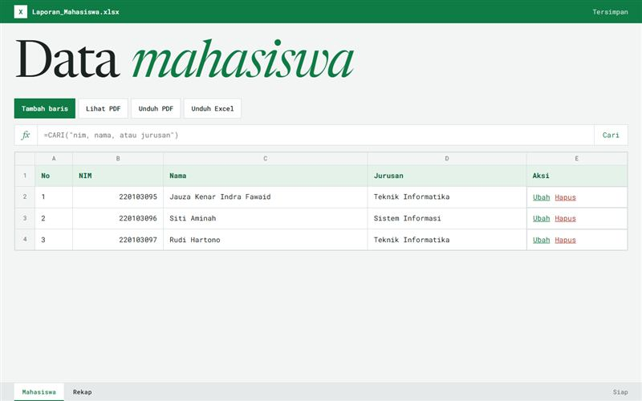

# Laporan Data Mahasiswa

CRUD Laravel dengan rekap per jurusan serta ekspor Excel dan PDF.

**Demo:** https://portofolio-jauza-fawaid.netlify.app/DATA-MAHASISWA-LAPORAN/ (pratinjau statis dengan data contoh)



Aplikasi Laravel untuk mengelola data mahasiswa, dengan pencarian, rekap per jurusan, serta ekspor Excel dan PDF.

## Fitur

- CRUD dengan validasi dan pesan berbahasa Indonesia
- Pencarian dan paginasi
- Rekap jumlah dan porsi per jurusan
- Ekspor Excel dengan judul kolom, dan laporan PDF yang memuat seluruh data

## Menjalankan

Butuh PHP 8.1 atau lebih baru dengan ekstensi `zip`, `gd`, dan `mbstring`. Di XAMPP, aktifkan `extension=zip` dan `extension=gd` pada `php.ini`.

```bash
composer install
cp .env.example .env
php artisan key:generate
php artisan migrate
php artisan serve
```

## Pengujian

```bash
php artisan test
```

Pengujian memakai SQLite di memori dan tidak menyentuh database lokal.

## Teknologi

Laravel 10, Blade, Laravel Excel, mPDF, MySQL
